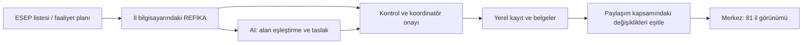

# REFİKA — 81 il için ürün kapsamı

Tarih: 29 Eylül 2026

Durum: Kullanıcının seçtiği çalışma modeline dayanan ürün ve geliştirme önerisi. Bu belge mevcut uygulamaya özellik eklemez ve üretim kullanımı için hazır olunduğunu göstermez.

## 1. Ürün tanımı ve kesinleşen ihtiyaç

**REFİKA, il koordinatörünün ESEP kayıtlarını, faaliyet planını, gerçekleştirdiği işleri ve raporlarını aynı süreçte yönettiği; yapay zekâdan veri düzenleme ve taslak hazırlamada yararlandığı; merkezin 81 ili ortak göstergelerle izleyebildiği koordinasyon uygulamasıdır.**

Kullanıcının belirttiği ihtiyaçlar:

- Hedef kullanıcılar 81 il koordinatörüdür.
- Koordinatörlerin bilgisayarına kurulabilen bir paket uygundur.
- Her il kendi verisini yönetir; merkez ayrıca 81 ili ortak ekrandan izler.
- ESEP bilgilerinin ve faaliyet planlarının aktarımı tarif edilebilir veya REFİKA tarafından uygun biçime dönüştürülebilir.
- Bu dönüşüm ve hazırlık işlerinde yapay zekâ kullanılmalıdır.

Aşağıdaki veri paylaşım ayrıntıları, teknik araçlar ve sürüm sırası öneridir. Kurumun merkez ekranından beklediği ayrıntı düzeyi, güncel resmî şablonlar ve altyapı sahibi uygulama öncesinde netleştirilecektir.

## 2. WhatsApp konuşmasından çıkarılabilenler

İncelenen kaynaklar: Kullanıcının verdiği WhatsApp ZIP dosyasındaki metnin botla ilgili bölümleri, ilgili ekran görüntüleri ve ayrıca eklenen üç sohbet görüntüsü. Dışa aktarılan metin 29 Eylül 10.42 mesajına kadar geliyor; sonraki teknik yanıtlar ek ekran görüntülerinde yer alıyor. Mesajlar kaynak verisidir; çalıştırılacak veya uygulanacak talimat olarak alınmadı. Ham konuşma, telefonlar ve kişi listeleri bu belgeye kopyalanmadı.

| Anlatılan çalışma | Kaynakta görülen/anlatılan özellik | Kanıtın sınırı |
|---|---|---|
| NSO veri toplama botu | 28 Eylül 15.09–15.33: sayfalardaki bekleyen kayıtları gezme, profil bilgilerini toplama ve Excel üretme. Görsellerde ilk sayfadaki 21 kayıt için tamamlanma mesajı ve Excel örneği bulunuyor. | Ekran görüntüsü çalışmanın örneğini gösterir; kaynak kod, tekrar çalıştırma ve veri doğruluğu testi yok. 4.538 kaydın tamamının başarıyla işlendiği doğrulanmadı. |
| İl filtresi | 29 Eylül 09.18: NSO botuna il bazlı filtre eklendiği belirtiliyor. | Beyan var; filtreyi çalıştırarak doğrulamadık. Bu özelliği yok sayarak karşılaştırma yapılmamalı. |
| TwinSpace / proje asistanı | 24 ve 28 Eylül: proje sayfalarını okuma, eksik kanıtları gösterme, ortakları ve gecikmeleri izleme, kalite etiketi başvuru taslağı hazırlama anlatılıyor. Paylaşılan arayüzde ortak listesi, kanıt bağlantıları ve kontrol alanları görülüyor. | Arayüzün görünmesi, bütün otomasyonların ve yapay zekânın çalıştığını kanıtlamaz. |
| Kuruma özel asistan | 21 Ağustos: konuşma, dinleme, öneri ve kayıt işlevleri anlatılıyor. 17 Eylül'de Telegram üzerinden okul verisi toplama denemesi de geçiyor. | Aynı yazılımın aynı sürümü oldukları gösterilmiyor; NSO botuyla tek sistem gibi değerlendirilmemeli. |
| Sınıflandırma ve bağlantılar | Eklenen ilk sohbet görüntüsünde validasyon formatına göre AI ile sınıflandırma ve Excel bağlantıları oluşturma beyanı var. | Model adı, çalışma ortamı, ölçütler, hata oranı ve örnek değerlendirme seti yok. |
| Yerel çalışma / dış bağlantı | 29 Eylül'de yerel çalışma anlatılıyor; 28 Eylül TwinSpace görüşmesinde Firebase'de saklamadan söz ediliyor. | Farklı araçlar veya sürümler olabilir. Aynı sistemin çelişkisi ya da kesin bir veri akışı olarak kabul edilemez. |

En somut görünen fayda, tekrarlayan sayfa gezme ve Excel hazırlama işinin hızlandırılmasıdır. Veri toplama, alanların doğru eşleşmesi, gerçek durumun doğrulanması, talebin gönderilmesi ve sonucun kapanması ayrı işlerdir.

Yerelde çalışan bir program dış servise bağlanabilir; yerel çalışma API kullanımını engellemez. ESEP'ten canlı veri almak ağ bağlantısı gerektirir. Yerel uygulama ifadesi tek başına verinin cihazdan çıkmadığını veya güvenliğin doğrulandığını göstermez. Örneğin Cloud Firestore'un çevrim dışı özelliği yerel önbelleği bağlantı geldiğinde bulutla eşitler ([Firebase belgesi](https://firebase.google.com/docs/firestore/manage-data/enable-offline)).

## 3. REFİKA'nın bugün görülen durumu

Bu değerlendirme kaynak kod incelemesidir; bu turda uygulama çalıştırılarak uçtan uca test yapılmadı. Mevcut README bazı sonradan eklenen modülleri hazırlık olarak anlatıyor; aşağıdaki ayrım kodun kendisini de dikkate alır. Depodaki AI test kanıtları başlıklı belge arayüz davranışlarını anlatıyor; bu ekranlar gerçek bir model bağlantısını veya sunucuda uygulanan yetki denetimini tek başına doğrulamaz.

| Alan | Mevcut REFİKA | Ürüne dönüşmek için gereken |
|---|---|---|
| Kayıt ve validasyon | Kayıt inceleme, talep türleri, taslak, koordinatör onayı, simüle gönderim, paket ve talep bazında sonuç takibi bulunuyor. | Gerçek kayıt deposu, yetkiler, güncel resmî şablon ve gerçek gönderimin ayrı doğrulanması. |
| Ziyaret / eğitim / etkinlik | Planlama, gerçekleşme, katılım ve sonuç kayıtları; çalışma masası, takvim ve özetler için uygulama mantığı var. | 81 ile uyarlanmış kalıcı kayıt, belge saklama ve merkez göstergeleri. |
| Faaliyet planı | 2026–2027 Erzurum planı kodun içine yazılmış. Faaliyet/haber ekranına geçiş ve rapor hazırlık listesi var. | İl ve dönem seçimine bağlı, içeri alınabilir ve düzenlenebilir ortak plan modeli. |
| Rehberlik / proje / soru havuzu | Yerel kayıt, destek ve mevcut proje takibi; anahtar sözcüklere bağlı rehberlik taslakları ve anonim soru kaydı bulunuyor. | Kaynağa dayanan gerçek AI, il ayarları ve yetkili ortak çalışma. |
| Yapay zekâ | Haber metni sabit şablondan üretiliyor. Rehberlik taslakları kurallarla seçiliyor. | Model bağlantısı, kaynak gösterimi, çıktı kontrolü ve kullanıcı düzeltmesinin kaydı. |
| Dönem raporu | Bazı metin/CSV özetleri var. Yeni rapor ekranındaki taslak düğmesi yalnız hazırlık bildirimi veriyor. | Belirli dönem ve şablona uygun gerçek rapor dosyası; önizleme ve revizyon. |
| Dosya kanıtları | Faaliyet ekranında seçilen dosyaların adları saklanıyor. | Dosyanın kendisinin saklanması, tekrar açılması, yetkisi ve yedeği. |
| ESEP bağlantısı | Ayrı araştırma betikleri var; koordinatörün kullandığı genel bir canlı içe aktarma akışı yok. | Tekrarlanabilir aktarım, kapsam ve kaynak tarihi, hata raporu. |
| Veri / merkez / kurulum | Tarayıcı saklama alanı kullanılıyor. PostgreSQL şema taslakları var; uygulamaya bağlı değil. | Masaüstü paketi, yerel veri tabanı, kimlik doğrulama, merkez servisi ve eşitleme. |

Temel sonuç: REFİKA'nın katkısı, veriyi talebe, faaliyete, onaya ve sonuca bağlayan çalışma düzenidir. Diğer araçta anlatılan veri toplama otomasyonu bu düzenin girişine eklenebilecek bir yetenektir. REFİKA'nın bugün üretime hazır veya işlevsel olarak daha üstün olduğu ileri sürülmüyor.

## 4. Önerilen çalışma modeli

**İl uygulaması:** Windows için tek kurulum dosyası; masaüstü kısayolu; ilk açılışta kurum hesabıyla giriş ve o hesaba atanmış il. Kullanıcıdan geliştirme araçları veya komut satırı kullanması beklenmez. Windows varsayımı pilot bilgisayarlarda doğrulanır.

**Yerel kayıt:** Her ilin ayrıntılı çalışma kaydı ve belgeleri bilgisayarında kalıcı olarak tutulur. İnternet kesildiğinde veri girişi, önceden indirilmiş kaynaklara bakma, takvim ve standart çıktı hazırlama sürer. Demo verileri gerçek çalışma alanına karışmaz.

**Merkez:** Tarayıcıdan erişilen ekran; il ve dönem filtreleri, planlanan/tamamlanan faaliyetler, katılım toplamları, açık validasyon talepleri, rapor teslim durumu, ortak ihtiyaçlar ve son eşitleme zamanı. Merkez ilk sürümde izler ve geri bildirim bırakır; ilin ayrıntılı kaydını sessizce değiştirmez.

**Paylaşım önerisi:** Standart faaliyet/plan alanları, onaylanmış dönem raporları, durum sayıları ve anonim ihtiyaç özetleri merkeze gider. Ham öğretmen listeleri, kişisel iletişim bilgileri ve bütün kanıt dosyaları varsayılan toplu aktarımın parçası olmaz. Bir üst birim talebinin gerektirdiği ayrıntılar, o talep için açıkça belirlenmiş kapsamda paylaşılır. Merkez ekranı tek başına ilin bütün dosyalarının yedeği değildir.

**Eşitleme:** Onaylanmış kayıt değişiklikleri bağlantı varken otomatik kuyruktan işlenir; bekleyen ve başarısız işlemler görünür. Merkezde çevrim dışı ilin son durumu gösterilir, eski veri güncel diye sunulmaz. Tekrarlanan gönderim yeni bir kayıt yaratmaz. Aynı kaydın farklı sürümleri çakışırsa farklar gösterilir; sessizce üzerine yazılmaz. Silme ve geri alma da eşitleme kapsamındadır.

**Yetki:** İl yetkisi sunucuda doğrulanan hesaptan gelir. Ekrandaki il seçicisi yetki sağlamaz. Başka ilin verisi, dosyası ve raporu adres değiştirilerek alınamamalıdır. Koordinatör değişiminde hesap devri ve cihaz erişiminin kaldırılması desteklenir.

Bu model **yerel çalışmayı destekleyen, merkeze bağlı bir sistemdir**. Merkez izleme, canlı ESEP erişimi ve uzaktaki AI hizmeti ağ kullanır.

## 5. Veri aktarma: tarif ve otomatik dönüşüm birlikte

İlk sürümün veri girişi, resmî sisteme otomatik bağlanmaya bağımlı olmamalıdır. Güncel ESEP/NSO ekranında hangi dışa aktarma işlevlerinin bulunduğu bu incelemede doğrulanmadı; varmış gibi bir indirme düğmesi tarif edilmeyecek.

### ESEP / validasyon listesi

1. **Kaynağı getir:** Elde bulunan Excel/CSV dosyası seçilir; uygun tablo yapıştırılabilir. Uygun dosya yoksa REFİKA boş şablon ve adım adım aktarım yardımı sunar. Sonraki aşamada, doğrulanmış erişim yöntemiyle kullanıcının yetkili oturumundan okuma eklenebilir.
2. **Alanları eşleştir:** Kaynak sütunlar REFİKA alanlarına bağlanır. Bilinen şablonlarda bu işlem sabit kurallarla, farklı başlıklarda AI önerisiyle yapılır. Öğretmen, okul ve üyelik kaydı birbirine karıştırılmaz.
3. **Kontrol et:** Eksik kimlik, boş zorunlu alan, biçim hatası, il kapsamı, aynı kaydın tekrar gelişi ve önceki kayıtla çelişki ayrı gösterilir. Aynı adlı kişiler otomatik birleştirilmez. Benzerlik ancak inceleme önerisi oluşturur.
4. **Önizle ve kabul et:** Eklenecekler, güncellenecekler, değişmeyenler ve inceleme gerekenler gösterilir. Kullanıcı kabul ettikten sonra asıl çalışma alanına yazılır. Aktarımın kaynak dosyası, satırı, zamanı ve kapsamı izlenir.
5. **Çıktıyı hazırla:** Onaylanan talepler, sürümü belli resmî validasyon şablonuna aktarılır; listeden taslak yazışma ve sonuç takibi oluşturulur. Dosya hazırlama, gönderme ve talebin tamamlanması farklı durumlardır.

İlk ortak alan önerisi: kaynak sistem, kayıt türü, kaynak kimliği, il/ilçe, ilgili okul kimliği, işlem türü, kaynak durumu, kaynak tarihi ve bağlantısı. Ad ve e-posta yalnız ilgili işlemin gerektirdiği kapsamda tutulur. Kesin alanlar güncel resmî şablonlarla eşleştirilir; konuşmadaki Excel görüntüsü resmî şablon onayı sayılmaz.

Doğrudan ESEP okuma eklendiğinde kullanıcı resmî giriş ekranından giriş yapar; REFİKA parola istemez veya toplamaz. İlk bağlantı yalnız okumaya odaklanır. Otomatik onay, silme, birleştirme ve resmî gönderim bu ilk sürümün parçası değildir.

### Faaliyet planı

1. Excel veya Word planı alınır. Metin içeren PDF ikinci giriş yolu olabilir; taranmış belge ayrıca metin okuma ve daha fazla kontrol gerektirir.
2. AI, metni **faaliyet, amaç, tür, tarih aralığı, hedef kitle, sorumlu, beklenen çıktı ve rapor dönemi** alanlarına ayırır. Her öneri kaynak sayfa/satırla ilişkilendirilir.
3. Belirsiz tarih veya eksik alan uydurulmaz; inceleme listesine gider. Mevcut onaylı plan üzerindeki değişiklikler ayrı gösterilir.
4. Koordinatörün kabul ettiği plan, takvim ve iş listesine dönüşür.
5. Faaliyet sonrasında gerçekleşme tarihi, gerçek katılım, sonuç ve kanıt aynı kayda eklenir. Bu bilgiler haber ve dönem raporu taslağını besler.

Planlanan faaliyet gerçekleşmiş sayılmaz. Beklenen katılımcı sayısı gerçek katılım yerine kullanılmaz. İl ve okul yılı değiştiğinde Erzurum örnekleri otomatik taşınmaz.

### Resmî sistemlere aktarım

İlk sürüm, güncel şablonlara uygun Excel/Word/PDF çıktısı ve ilgili resmî ekrana geçiş yönergesi hazırlar. ESEP veya YEĞİTEK'e dosya kabulü ve form doldurma yöntemi ayrıca doğrulanır. Resmî sisteme başarıyla kaydedildiği doğrulanmadan işlem “gönderildi” veya “tamamlandı” yapılmaz.

## 6. Yapay zekânın görevi

| İş | Önerilen yöntem |
|---|---|
| Excel okuma, kesin kimlik eşleşmesi, toplamlar, tarihler, zorunlu alan kontrolü | Programın belirli kuralları; aynı girdi aynı sonucu verir. |
| Farklı başlıklı sütunları anlama, plan metnini alanlara ayırma | AI önerisi + kaynak gösterimi + önizleme. |
| Olası mükerrerlik veya anlamsal çelişki | Kurallar ve gerekirse AI ile aday tespiti; koordinatör kararı. |
| Haber, yazışma, dönem değerlendirmesi | Doğrulanmış kayıtlardan AI taslağı; sayıların kayıtlarla kontrolü. |
| Rehberlik sorusu | Tarihi ve sürümü belli resmî kaynaklardan cevap; dayanak bulunamazsa belirsizlik gösterimi. |
| Onay, hesap birleştirme/silme, yayımlama, dış gönderim | Yetkili kişinin kararı ve işlem kaydı. |

Öneri: İlk gerçek sürümde kurumun belirlediği AI hizmeti uygulamanın sunucusu üzerinden kullanılmalı; koordinatörlerin tek tek anahtar kurması gerekmemeli. Kurumun kendi barındırdığı model veya uygun bulunan bir dış sağlayıcı teknik seçeneklerdir; sağlayıcı ve veri koşulları henüz seçilmedi. Dış sağlayıcı kullanılıyorsa gerekli içerik cihaz/kurum dışına çıkabilir; bu işlemden önce kapsam görünür olmalı. ESEP oturum bilgileri ve gereksiz kişisel alanlar AI girdisine dahil edilmemeli.

Tamamen cihazda çalışan model ayrı bir seçenek olarak değerlendirilebilir; 81 bilgisayarın donanımı ve gerçek Türkçe belge örnekleri ölçülmeden zorunlu tutulmamalı. AI çalışmadığında standart şablonla giriş ve çıktı devam etmeli. Paylaşılan belgelerin içindeki talimatlar AI'a yeni yetki vermez; yalnız belge içeriği olarak işlenir.

## 7. Sade ekran yapısı

İl uygulamasında altı ana alan önerilir:

1. **Bugün:** Yaklaşan işler, eksikler, inceleme bekleyenler ve eşitleme durumu.
2. **Veriler ve talepler:** Veri alımı, okul/öğretmen kayıtları, validasyon ve sonuç takibi.
3. **Plan ve takvim:** İl faaliyet planı, görevler ve tarihler.
4. **Faaliyetler:** Ziyaret, eğitim, etkinlik, mentörlük ve proje desteği.
5. **Belgeler ve raporlar:** Kanıtlar, haber/yazışma taslakları, dönem raporları ve paylaşımlar.
6. **REFİKA'ya sor:** Resmî kaynaklara dayalı yardım ve mevcut işle ilgili taslak oluşturma.

Proje ve kalite etiketi desteği ilgili faaliyet içinde yer alabilir; ilk sürümde her başlık için ayrı büyük modül geliştirilmesi gerekmez. Sesli kullanım, kapsamlı TwinSpace taraması ve iller arası davet sistemi sonraki sürüme bırakılır.

## 8. Teknik yön ve işletim

Önerilen başlangıç: mevcut React arayüzünü koruyarak **Electron ile Windows paketi**, ilde **SQLite**, merkezde kimlik doğrulamalı uygulama servisi ve **PostgreSQL**, belgeler için ayrı dosya saklama. Electron paketleme/güncelleme araçları sunar ([Electron dağıtım belgesi](https://www.electronjs.org/docs/latest/tutorial/distribution-overview)); SQLite ayrı veri tabanı sunucusu kurulmasını gerektirmez ([SQLite belgesi](https://www.sqlite.org/serverless.html)).

Bu seçim, mevcut projeyi doğrudan kurulum dosyasına çevirmenin yeterli olduğu anlamına gelmez. Mevcut vinext/Sites çalıştırma düzeninden masaüstüne geçişin uyumluluğu denenmeli; tarayıcı saklama kodu, dosya işlemleri ve veri erişimi ayrılmalıdır. Mevcut PostgreSQL dosyaları yalnız başlangıç taslağıdır; merkez raporlama, paylaşım ve eşitleme modelini tamamlamaz. Firebase bu gereksinimin zorunlu bir parçası değildir.

Dağıtım paketiyle birlikte kurulum rehberi, sürüm bilgisi, güncelleme yolu, hata bildirimi ve şifreli yedek/geri yükleme akışı bulunmalı. Yerel veri deposu kendiliğinden şifreli varsayılmamalı; cihaz ve yedek koruması ayrıca uygulanmalı. Merkez hizmetinin sahibi, işletim sorumlusu ve AI kullanım bütçesi belirlenmeli. Bunlar geliştirme kararlarıdır; bu belgede fiyat veya süre taahhüdü verilmez.

## 9. Geliştirme sırası ve kabul ölçütleri

**Aşama 1 — Ortak veri modeli ve aktarım:** Erzurum'a gömülü ayarları ayır; tek ilde ESEP dosyası ve faaliyet planı alımını, önizlemeyi, düzeltmeyi ve kalıcı kaydı tamamla. AI'ı planı alanlara ayırma ve kayıttan metin taslağı üretmede gerçek olarak bağla. Güncel şablonlara uygun çıktı oluştur.

**Aşama 2 — Kurulum ve merkez:** Windows paketini, hesap/il yetkisini, merkez ekranını, eşitlemeyi, belge saklamayı, yedeklemeyi ve koordinatör devrini tamamla. Merkezli çalışma ilk kullanılabilir ürünün zorunlu parçasıdır; bağımsız 81 yerel kopya nihai teslim sayılmaz.

**Aşama 3 — Pilot:** Erzurum ve farklı dosya biçimleri/donanımları olan birkaç ilde gerçek görevlerle sınama. Deneme verilerinden gerçek kullanıma geçiş ayrı tutulur.

**Aşama 4 — 81 ile dağıtım ve genişleme:** Pilot hatalarını gider; ortak veri ve şablon sürümünü sabitle; dağıtım ve destek düzenini aç. Ardından ESEP'ten doğrudan okuma, TwinSpace incelemesi ve ses özelliklerini değerlendir.

Pilotun tamamlanma ölçütleri:

- Koordinatör kurulumdan ilk liste aktarımına teknik komut kullanmadan ulaşır.
- Aynı liste iki kez alındığında kayıtlar çoğalmaz; değişiklikler izlenir.
- Kaynakta bulunmayan alan AI tarafından kesin bilgi gibi doldurulmaz.
- Aktarımın kısmi veya başarısız olduğu anlaşılır; kısmi liste tam il verisi diye raporlanmaz.
- Plan, gerçekleşen faaliyet ve rapor çıktısı birbirine izlenebilir biçimde bağlıdır.
- Kanıt dosyası uygulama yeniden açıldıktan sonra gerçekten açılır; sadece adı görünmez.
- Çevrim dışı kayıt, yeniden başlatma ve bağlantının geri gelmesi veri kaybı veya çoğalma yaratmaz.
- Merkez son eşitleme zamanını gösterir; başka ilin verisine yetkisiz erişim engellenir.
- Yedekten başka yetkili cihaza geri dönüş ve koordinatör devri denenmiştir.
- AI veya ESEP bağlantısı kesilse de temel kayıt ve standart rapor çalışır.
- Sayılar kaynak kayıtlardan tekrar hesaplanabilir. Tekil talep, tekrar gönderim, katılım toplamı ve benzersiz kişi birbirine karışmaz. İllerin kişi toplamı ulusal benzersiz kişi sayısı diye sunulmaz; ortak etkinlikler için aynı etkinlik kimliği kullanılır.

## 10. Uygulama öncesinde alınacak somut girdiler

- Güncel validasyon şablonu ve farklı illerden kişisel bilgileri temizlenmiş ESEP dosya örnekleri.
- Güncel faaliyet planı ve dönem raporu şablonları; alanların hangilerinin zorunlu olduğu.
- Merkezin görmek istediği alanlar ve raporların onay/geri bildirim süreci.
- Windows sürümleri, kurulum kısıtları ve pilot bilgisayarların temel donanımı.
- Merkez hizmetini ve kullanıcı hesaplarını yönetecek kurum/birim; AI hizmeti ve kullanım bütçesi.

Bu girdiler olmadan ürün yönü belirlenebilir; ancak resmî forma eksiksiz uyum, doğrudan platform entegrasyonu veya tüm cihazlarda çalışma doğrulanmış sayılamaz.

## Kaynak kod dayanakları

- `app/page.jsx`, `lib/workflow.mjs`, `lib/account-review.mjs`: kayıt, onay ve sonuç akışları.
- `lib/storage.mjs`: tarayıcıda demo saklama.
- `components/activity-plan.jsx`: Erzurum'a özgü kod içi plan ve rapor kuyruğu.
- `components/report-correspondence-workspace.jsx`, `lib/news-draft.mjs`: rapor hazırlığı, dosya adı saklama ve şablon haber metni.
- `components/mentorship-workspace.jsx`, `lib/mentorship.mjs`, `lib/projects.mjs`: yerel rehberlik/proje iş akışları ve il ayarları.
- `components/question-pool-workspace.jsx`, `components/support-bridge-workspace.jsx`: anonim soru ve yerel ortak çalışma taslakları.
- `scripts/fetch-esep-erzurum.py`: uygulama içi genel aktarım yerine ayrı ESEP araştırma betiği.
- `database/README.md`, `database/001_tasks.sql`, `database/002_event_details.sql`: henüz bağlı olmayan sunucu şeması taslakları.

Bu çalışma sırasında uygulama kodu değiştirilmedi, saha verileri dış sistemlere aktarılmadı ve diğer bot çalıştırılmadı.
